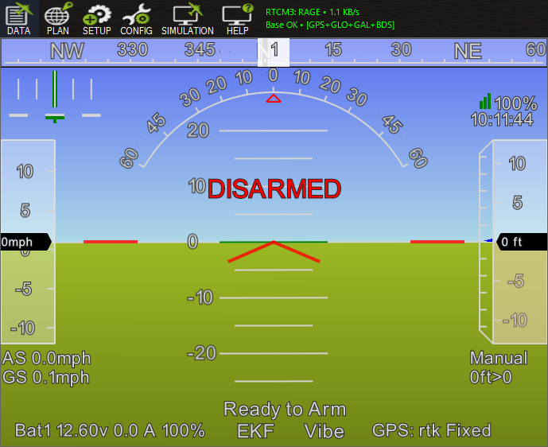

# Auto Injector Mission Planner Plugin

An automated RTK/GPS correction injection plugin for ArduPilot's [Mission Planner](https://ardupilot.org/planner/).

## Features

- **Automated Connection**: Automatically connects to the last configured RTCM3 stream (NTRIP, Serial/COM, TCP, or UDP) on Mission Planner startup.
- **Status Bar**: Displays in the top ribbon/toolbar (to the right of TitanPlanner's GPS stats or MissionPlanner's top navigation buttons):
  - **Stream Metrics**: Displays active mountpoint/port, throughput (KB/s), detected constellations (GPS, GLONASS, Galileo, BeiDou), and base station confirmation (`Base OK`).
  - **Hover Tooltip**: Message counts, throughput, base coordinates, and protocol settings.
  - **Quick Access**: Click the status indicator at any time to open the RTK/GPS Inject configuration window.
- **GGA & NTRIP 1.0 State Persistence**: Saves the **Send GGA** and **NTRIP 1.0** settings between sessions.

## Installation

1. Locate your Mission Planner installation directory (typically `C:\Program Files\Mission Planner\` or `C:\Program Files (x86)\Mission Planner\`).
2. Copy [`AutoInjector.cs`](AutoInjector.cs) into the `plugins/` directory.
3. Restart Mission Planner. The plugin will be compiled and loaded automatically on startup.
